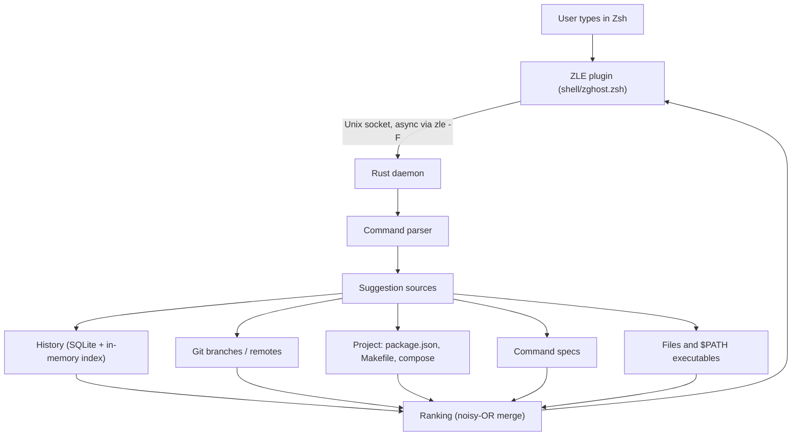

# zghost

Warp-style inline autosuggestions for Zsh, powered by a Rust daemon. You keep
your terminal and your shell. zghost adds ranked, context-aware ghost text as
you type.

```
$ git che|ckout feature/login        <- grey text is the suggestion
```

## Install

```sh
cargo install --path .
echo 'eval "$(zghost init zsh)"' >> ~/.zshrc
```

The first keystroke in a new shell starts the daemon automatically. On the
first start it imports your existing `$HISTFILE` once.

Do not load `zsh-autosuggestions` at the same time: both plugins draw into
`POSTDISPLAY`.

## Keys

| Key                         | Action                                           |
| --------------------------- | ------------------------------------------------ |
| `↑` / `↓`                  | Browse older / newer commands in Zsh history      |
| `→`, `Ctrl-F`               | Accept the whole suggestion (else move right)    |
| `End`, `Ctrl-E`             | Accept the whole suggestion (else end of line)   |
| `Alt-F`                     | Accept the next word                             |
| `Alt-N` / `Alt-P`           | Cycle through ranked alternatives                |
| `Tab`, `Ctrl-Space`          | Open the ranked completion menu                 |
| `↑` / `↓` in the menu       | Select the previous / next candidate            |
| `Enter`, `Tab` in the menu   | Insert the selected candidate without executing |
| `Esc` in the menu           | Dismiss suggestions                             |
| `Ctrl-X Tab`                | Invoke your original Zsh completion widget      |

Set `ZGHOST_NO_BINDINGS=1` before the `eval` to bind the widgets yourself
(`zghost-accept`, `zghost-accept-end`, `zghost-accept-word`, `zghost-next`,
`zghost-prev`, `zghost-tab`, `zghost-complete`). Set `ZGHOST_TAB_ACCEPT=1` to make Tab accept the
ghost text when one is shown, Warp style. Set `ZGHOST_HIGHLIGHT` (default
`fg=8`) to restyle the ghost text.

Set `ZGHOST_MENU_AUTO=1` before loading to open the menu while typing.
Typing edits the draft; the menu never executes a command on acceptance.
Automatic menus use built-in sources only. Explicit Tab/Ctrl-Space requests
also fetch native Zsh candidates when the built-in sources return none.
Native completion requires your usual `compinit` setup; if the adapter has
no candidates, the original completion widget remains the fallback.

## Completion discovery

Suggestions work before you know the first argument character: `git checkout `
offers branches, `npm run ` offers scripts, and `cat ` offers local paths.
Built-in command metadata supplies subcommands, flags, path-valued options,
and enumerated values without needing prior history. For example:

```text
cargo build --r             → cargo build --release
gh pr c                    → gh pr create
terraform pl               → terraform plan
kubectl get --output=      → kubectl get --output=yaml
```

The catalog includes Git, Cargo, Docker/Compose, npm/pnpm/yarn/bun, kubectl,
Homebrew, Go, gh, Terraform, SSH/SCP/rsync, curl, rg, find, Python/pip, uv,
Poetry, rustup, Helm, AWS, gcloud, just and CMake. It covers common syntax;
installed Zsh completion functions provide additional coverage on demand.
There is no built-in alias expansion or alias-aware dispatch.

Inline ghost text always extends what you typed. The explicit menu also
supports case-insensitive subsequences and one-character typos, so `git chek`
can discover `git checkout`. Prefix matches rank ahead of fuzzy matches.
Selecting a menu candidate replaces the word at the cursor, retaining later
arguments. Quoted file paths and spaces are escaped for insertion.

After upgrading, run `zghost stop` and reload your shell so the daemon and
plugin both use the updated completion protocol.

## Next-command prediction

zghost learns which kind of command usually follows another. It groups
commands by shape (the command plus its subcommand), so every
`git commit -m "..."` counts as `git commit`, even though each message is
different. If you usually push after committing, then after a commit:

```
$ git| push origin feature/login     <- typing `git` suggests the push
$ |git push origin feature/login     <- an empty prompt suggests it too
```

The empty-prompt suggestion only appears when the pattern is strong, judged by the exact previous line (`git checkout dev` -> `git pull`) or its shape. Accept
it with `→` like any other suggestion. Set `ZGHOST_NO_PREDICT=1` to turn it
off. A remembered `git push [-u] <remote> <branch>` is rewritten to the
branch you have checked out.

## Architecture



* **Plugin** (`shell/zghost.zsh`). A `line-pre-redraw` hook sends the buffer
  whenever it changes. Replies arrive through `zle -F` and are drawn into
  `POSTDISPLAY` with `region_highlight`, so typing never blocks on the daemon.
  Every request carries an id, and stale replies are dropped. Candidates that
  still match are kept between keystrokes, so ghost text doesn't flicker.
  `precmd` reports each finished command with its directory and exit status.
* **Daemon** (`src/daemon.rs`). One persistent connection per shell, one
  thread each. The socket is created with umask `077` (owner only), because it
  exposes your history.
* **Parser** (`src/parser.rs`). A small lexer that handles quotes, escapes,
  `|`/`&&`/`;` segments and `sudo`/`env`/`FOO=bar` prefixes. It finds the
  command and the word under the cursor.
* **Sources** (`src/sources/`). Each one implements:

  ```rust
  pub trait SuggestionSource: Send + Sync {
      fn name(&self) -> &'static str;
      fn suggest(&self, ctx: &Context) -> Vec<Suggestion>;
  }
  ```

  | Source        | What it suggests                                                         |
  | ------------- | ------------------------------------------------------------------------ |
  | `history`     | Full lines, scored by frequency, recency (by time and by command order), directory, what usually follows the previous command, and failure rate |
  | `git`         | Branches (most recent first) and tags for checkout/switch/merge/..., and remotes for push/pull. Rewrites remembered pushes to the current branch and drops remembered checkouts of refs this repo does not have |
  | `project`     | `npm/pnpm/yarn/bun run` scripts, `make` targets, `docker compose` services |
  | `specs`       | Subcommands, flags, option values and argument metadata for common CLIs |
  | `files`       | Paths for path-like words and file-taking commands (dirs only for `cd`)  |
  | `executables` | Commands on `$PATH` while typing the command word                        |

  Sources can also implement `rewrite` to adapt another source's line to
  the current context.

* **Ranking** (`src/engine.rs`). Source confidences are combined with
  noisy-OR, so sources that agree reinforce each other. A history line that
  extends a context completion (`git log` → `git log --oneline`) inherits that
  completion's support.

## Measuring quality

`zghost bench` replays your history file. Older commands train the index, and
the newest N are "typed" one character at a time. It also reports the
zsh-autosuggestions strategy (most recent match) as a baseline. It also
reports how often the empty-prompt prediction is shown and exactly right.

Results on this machine's history (≈4,900 commands, history source only):

| Test set | zghost keystrokes saved | Baseline | zghost predicted | Baseline | p99 latency |
| -------- | ----------------------- | -------- | ---------------- | -------- | ----------- |
| last 1000 | **48.5%** | 45.8% | **75.6%** | 74.1% | ~135 µs |
| last 2500 | **42.3%** | 39.7% | **72.7%** | 71.0% | |

The benchmark can't measure the directory boost, the context sources, or the
branch rewrite, because Zsh history files don't record the working directory
or branch. It also skips the `cd` target check for the same reason. The daemon
learns directories from live use. That's why the empty-prompt line looks low
in the benchmark: the guessed command shape is right about 70% of the time,
but most misses are `git push origin <branch>` with a different branch, which
the live rewrite fixes. Right now it shows on about 23% of prompts and is exactly right 44% of the time.

## Commands

```
zghost init zsh                     print the plugin (eval it in .zshrc)
zghost daemon [--foreground]        run the daemon (normally auto-started)
zghost suggest [--cwd D] [--after CMD] <buffer>
                                    one-shot ranked suggestions, with sources and timing;
                                    --after pretends CMD just ran ('' asks for a next-command guess)
zghost complete [--cwd D] [--cursor N] [--limit N] <buffer>
                                    explicit fuzzy completions; N is a character offset;
                                    prints insertion cursor and completed buffer
zghost bench [--test N]             replay history and score suggestion quality
zghost import [--histfile F]        one-time history import (also done on first start)
zghost status | stop                ping or stop the daemon
```

## Configuration

`~/.config/zghost/config.json` (every field is optional):

```json
{
  "max_suggestions": 5,
  "weights": { "history": 1.0, "git": 1.0, "project": 1.0, "specs": 1.0, "files": 1.0, "executables": 1.0 },
  "disabled_sources": [],
  "history": {
    "frequency_weight": 0.7,
    "half_life_days": 7,
    "recency_weight": 2,
    "short_half_life_minutes": 240,
    "short_recency_weight": 6,
    "directory_boost": 1.5,
    "sequence_boost": 2,
    "shape_sequence_boost": 6,
    "order_recency_weight": 4,
    "order_half_life": 20,
    "next_min_observations": 3,
    "next_min_probability": 0.5,
    "failure_penalty": 0.3
  }
}
```

Restart the daemon (`zghost stop`) after editing. Use `zghost bench` to check
whether a change helps on your own history.

Data lives in `~/.local/share/zghost/history.db`. Commands that start with a
space are never recorded.

## Not done yet

* **Full shell grammar.** The hand-written lexer handles common commands,
  quoting and separators, but does not implement all Zsh expansions.
* **Exhaustive CLI schemas.** Built-in specs cover common cases, not every
  tool/version. Native completions run on explicit invocation, not per key.
* **AI suggestions.** Adding one means adding another `SuggestionSource`. It
  should stay opt-in and run off the keystroke path.

## Development checks

```sh
cargo test
cargo clippy --all-targets -- -D warnings
cargo build
python3 tests/history_navigation.py
python3 tests/completion_menu.py
```

The shell tests use isolated PTYs, history/config directories and a test
daemon; they do not load your shell configuration or command history.

To measure source latency and allocation traffic with an isolated, synthetic
1,500-file fixture (without reading your history):

```sh
cargo run --release --example performance
```

This reports allocated bytes per query, not resident memory. Executable and
Git/project cache hits share their stored lists. Git and project caches each
retain at most 64 recently used locations, reloading evicted data on demand;
Git's three-second TTL and project-file mtime checks still apply. Learned
history is retained in full, so total memory still depends on history size.
