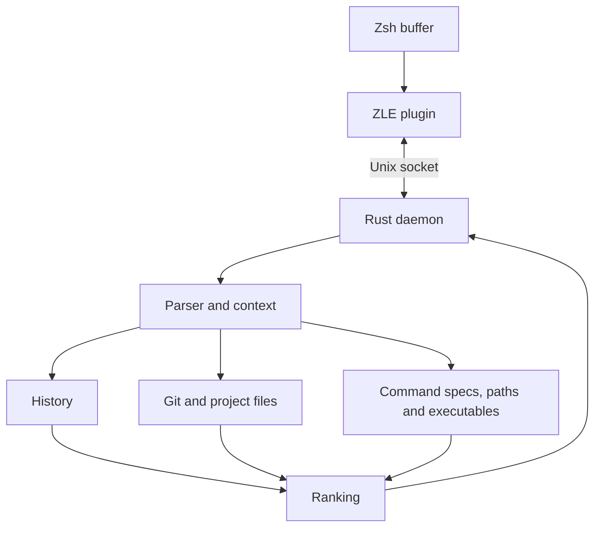

# zghost

**Context-aware autosuggestions and completions for Zsh, powered by Rust.**

Get Warp-style ghost text in your existing terminal. zghost combines your command
history with Git context, project scripts, local files, and built-in command
metadata to suggest what to type next.

```text
$ git che│ckout feature/login
         └─ suggested text; press → to accept
```

[Quick start](#quick-start) · [Key bindings](#key-bindings) ·
[Configuration](#configuration) · [Development](#development)

## What it does

- **Learns from your history.** Ranks commands by frequency, recency, working
  directory, previous commands, and exit status.
- **Understands your project.** Suggests Git branches and remotes, package
  scripts, Makefile targets, and Docker Compose services.
- **Helps discover commands.** Offers subcommands, flags, option values, files,
  and executables without requiring prior history.
- **Supports fuzzy completion.** The completion menu handles subsequences and
  one-character typos, while inline suggestions always extend what you typed.
- **Predicts your next command.** Learns patterns such as pushing after a commit
  and adapts remembered pushes to the current branch.
- **Works locally.** Uses a Rust daemon, a Unix socket, and a SQLite history
  database. No AI service or API key is required.

## Quick start

### Requirements

- A Unix-like environment with Zsh and its `zsh/net/socket`, `zsh/zselect`,
  `zsh/datetime`, and `zsh/zutil` modules.
- Rust and Cargo, plus a C compiler to build the bundled SQLite dependency.
- Git to clone this repository and use Git-aware suggestions.

### 1. Install from source

```sh
git clone https://github.com/itsmejay80/zghost.git
cd zghost
cargo install --path .
```

Make sure Cargo's binary directory, usually `~/.cargo/bin`, is on your `PATH`.

### 2. Enable it in Zsh

Add this line to `~/.zshrc`, after your shell framework and completion setup:

```zsh
eval "$(zghost init zsh)"
```

Open a new terminal or reload your configuration:

```zsh
source ~/.zshrc
```

The daemon starts automatically when suggestions are first requested and imports
your existing `$HISTFILE` once. If `HISTFILE` is unset, it uses `~/.zsh_history`.

> Disable `zsh-autosuggestions` before enabling zghost. Both plugins use Zsh's
> `POSTDISPLAY` to draw ghost text.

### 3. Try it

Type one of these commands, including the trailing space, to discover candidates:

```text
git checkout     → branches
npm run          → package scripts
cat              → local files
```

Press **Tab** to open the ranked completion menu, or **→** to accept inline ghost
text. Accepting a menu candidate inserts text without executing the command.

## Key bindings

| Key | Action |
| --- | --- |
| `↑` / `↓` | Browse older / newer commands in Zsh history |
| `→`, `Ctrl-F` | Accept the whole inline suggestion, or move right |
| `End`, `Ctrl-E` | Accept the whole inline suggestion, or move to the end |
| `Alt-F` | Accept the next word |
| `Alt-N` / `Alt-P` | Cycle through ranked alternatives |
| `Tab`, `Ctrl-Space` | Open the ranked completion menu |
| `↑` / `↓` in the menu | Select the previous / next candidate |
| `Enter`, `Tab` in the menu | Insert the selected candidate |
| `Esc` in the menu | Dismiss the menu |
| `Ctrl-X Tab` | Invoke your original Zsh completion widget |

The `Ctrl-F` and `Alt-*` bindings are installed in the Emacs keymap. Arrow, End,
and menu-opening bindings are also installed in the Vi insert keymap.

## Suggestions in practice

### Discover commands and arguments

Built-in metadata covers common CLI syntax, including Git, Cargo, Docker/Compose,
npm/pnpm/yarn/bun, kubectl, Homebrew, Go, gh, Terraform, SSH/SCP/rsync, curl, rg,
find, Python/pip, uv, Poetry, rustup, Helm, AWS, gcloud, just, and CMake.

```text
cargo build --r        → cargo build --release
gh pr c                → gh pr create
terraform pl           → terraform plan
kubectl get --output=  → kubectl get --output=yaml
```

Explicit Tab/Ctrl-Space requests also try native Zsh completions when built-in
sources return no candidates. This requires your usual `compinit` setup. If the
adapter finds nothing, zghost falls back to your original completion widget.

The explicit menu can turn `git chek` into `git checkout`. Prefix matches rank
before fuzzy matches. Selecting a candidate replaces the word at the cursor,
preserves later arguments, and escapes file paths for shell insertion.

### Predict what comes next

zghost groups commands by their command and subcommand: different
`git commit -m "..."` commands all teach the same `git commit` pattern. If a push
usually follows a commit, zghost can suggest it from a short prefix or an empty
prompt.

Empty-prompt suggestions require a sufficiently strong pattern from the exact
previous command or its command shape. A remembered
`git push [-u] <remote> <branch>` is adapted to the branch currently checked out.

## Configuration

### Shell options

Set these **before** the `eval` line in `~/.zshrc`:

| Variable | Effect |
| --- | --- |
| `ZGHOST_NO_PREDICT=1` | Disable suggestions on an empty prompt |
| `ZGHOST_TAB_ACCEPT=1` | Make Tab accept inline ghost text when present |
| `ZGHOST_MENU_AUTO=1` | Open the completion menu while typing |
| `ZGHOST_HIGHLIGHT='fg=8'` | Set the ghost-text style; `fg=8` is the default |
| `ZGHOST_NO_BINDINGS=1` | Skip default bindings and bind widgets yourself |

For example:

```zsh
ZGHOST_NO_PREDICT=1
ZGHOST_HIGHLIGHT='fg=8'
eval "$(zghost init zsh)"
```

Automatic menus use built-in sources only; native Zsh completions run on explicit
invocation. To bind your own keys, use widgets such as `zghost-accept`,
`zghost-accept-end`, `zghost-accept-word`, `zghost-next`, `zghost-prev`,
`zghost-tab`, and `zghost-complete`.

### Ranking and sources

Create `~/.config/zghost/config.json` to override defaults. Every field is
optional; for example:

```json
{
  "max_suggestions": 5,
  "weights": {
    "history": 1.0,
    "git": 1.0,
    "project": 1.0,
    "specs": 1.0,
    "files": 1.0,
    "executables": 1.0
  },
  "disabled_sources": [],
  "history": {
    "frequency_weight": 0.7,
    "half_life_days": 7,
    "recency_weight": 2,
    "short_half_life_minutes": 240,
    "short_recency_weight": 6,
    "directory_boost": 1.5,
    "sequence_boost": 2,
    "shape_sequence_boost": 6,
    "order_recency_weight": 4,
    "order_half_life": 20,
    "next_min_observations": 3,
    "next_min_probability": 0.5,
    "failure_penalty": 0.3
  }
}
```

Run `zghost stop` after changing the configuration. The daemon restarts on the
next suggestion request. Use `zghost bench` to evaluate ranking changes against
your own history.

### Local data

| File | Default location |
| --- | --- |
| Configuration | `~/.config/zghost/config.json` |
| History database | `~/.local/share/zghost/history.db` |
| Daemon socket | `$TMPDIR/zghost-<uid>.sock`, or `/tmp/zghost-<uid>.sock` |

`XDG_CONFIG_HOME` and `XDG_DATA_HOME` override the configuration and data base
directories. The daemon socket is restricted to its owner. Commands beginning
with a space are skipped when recording and importing history.

## Command reference

```text
zghost init zsh
zghost daemon [--socket P] [--histfile F] [--foreground]
zghost suggest [--cwd DIR] [--limit N] [--after CMD] <buffer...>
zghost complete [--cwd DIR] [--cursor N] [--limit N] <buffer...>
zghost bench [--histfile F] [--test N]
zghost import [--histfile F]
zghost status [--socket P]
zghost stop [--socket P]
```

Inspect suggestions and completions directly:

```sh
zghost suggest 'git che'
zghost suggest --after 'git commit -m "example"' ''
zghost complete --cwd . 'cargo build --r'
zghost status
```

`complete` uses a character offset for `--cursor` and prints the insertion cursor
and completed buffer. `suggest` reports sources and timing. `import` performs the
one-time history import normally handled at daemon startup.

## Updating and troubleshooting

To update an existing checkout:

```sh
git pull --ff-only
cargo install --path . --force
zghost stop
```

Then open a new shell so the plugin and daemon use the same protocol version.
If the daemon is already stopped, the `stop` command may report that no daemon
is running.

| Problem | What to check |
| --- | --- |
| `zghost: command not found` | Ensure Cargo's binary directory is on `PATH`. |
| Ghost text is missing or conflicting | Disable other autosuggestion plugins and load zghost after your shell framework. |
| Native completions are missing | Initialize `compinit` before loading zghost, then request completions with Tab or Ctrl-Space. |
| Suggestions seem stale after an update | Run `zghost stop` and open a new shell. |

To uninstall, remove the initialization line from `~/.zshrc`, run `zghost stop`,
and run `cargo uninstall zghost`. The local history database remains in the data
directory listed above.

## How it works



The [Zsh plugin](shell/zghost.zsh) sends buffer changes and receives replies
asynchronously through `zle -F`. Request IDs let it discard stale replies. The
[daemon](src/daemon.rs) maintains one connection and thread per shell.

[Suggestion sources](src/sources/) propose candidates, and the
[engine](src/engine.rs) combines their confidence scores so agreement raises a
candidate's rank. The [history index](src/sources/history.rs) learns from commands,
working directories, and exit statuses, with [SQLite persistence](src/store.rs).

### Current limitations

- The parser handles common quoting, escapes, and command separators, but does
  not implement the full Zsh grammar or all expansions.
- Built-in command specs cover common cases rather than every tool version.
- Alias expansion and alias-aware dispatch are not implemented.
- AI-generated suggestions are not implemented.

## Development

Run the Rust checks, build the binary, and exercise the Zsh integration:

```sh
cargo test
cargo clippy --all-targets -- -D warnings
cargo build
python3 tests/history_navigation.py
python3 tests/completion_menu.py
```

The Python tests require Python 3 and Zsh. They use isolated PTYs, configuration,
history files, and a test daemon without loading your personal shell setup.

### Measure suggestion quality

```sh
zghost bench --test 1000
```

The benchmark trains on older history and replays the newest commands one
character at a time. It reports keystrokes saved, prediction quality, latency,
and a most-recent-match baseline similar to `zsh-autosuggestions`.

Results depend on your history. History-file replay cannot measure directory
boosts, project sources, or live branch rewriting because Zsh history does not
record that context. It also skips checking whether historical `cd` targets exist.

### Measure source performance

```sh
cargo run --release --example performance
```

This probe uses an isolated, synthetic 1,500-file fixture without reading your
history. It reports latency and allocated bytes per query, rather than resident
memory. Git and project caches retain up to 64 recently used locations each;
learned history is retained in full, so total memory depends on history size.
